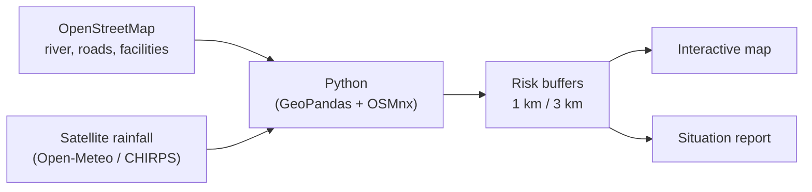

# 🌍 Coding for Disaster and Risk Management

**Beginner-friendly Python and geospatial lessons for humanitarian work, built on real case studies from South Sudan.**

[](https://colab.research.google.com/github/anguzamwasia/Coding-for-Disaster-and-Risk-Management/blob/main/Guide_1.ipynb)


---

##  About

When a disaster strikes, responders first need to know **where**:
- Where is the water rising?
- Which schools and clinics are inside the danger zone?
- Which roads can still carry relief supplies?

This repository teaches people with **no prior coding experience** to answer these questions with free, open tools: Python, OpenStreetMap, satellite rainfall data and interactive web maps.

Every lesson is a **Google Colab notebook**, so you don't need to install anything. Open it in your browser and run the cells from top to bottom.

---

##  Case studies

| Case study | Hazard | Location | What you build |
| :--- | :--- | :--- | :--- |
| **Guide 1** |  Flood | Bor South, Jonglei State (White Nile) | River buffers, facilities at risk, flooded roads, an interactive flood map and a situation report |
| **Guide 2** *(planned)* |  Drought | Kapoeta East, Eastern Equatoria | Rainfall anomaly (CHIRPS), drought severity classes, water points and population exposed |
| **Guide 3** *(planned)* |  Flood mapping | Bor, White Nile | Copernicus EMS-style maps from Sentinel-1 radar, affected buildings and households, printable PDFs |

---

##  Guide 1: Flood risk along the White Nile (Bor South)

**Status:**  in progress. Blocks 1–3 are published; the rest will follow.

| Block | Topic | Key concept | Status |
| :---: | :--- | :--- | :---: |
| 1 | Install the libraries | `pip`, what a library is | ✅ |
| 2 | Imports and study location | Variables, coordinates (lat/lon) | ✅ |
| 3 | Download the River Nile from OpenStreetMap | OSM tags, `osmnx`, vector lines | ✅ |
| 4 | Download hospitals, schools and roads | Points vs polygons, centroids, missing data | ⏳ |
| 5 | Convert degrees to metres (UTM 36N) | Projections: EPSG:4326 vs EPSG:32636 | ⏳ |
| 6 | Flood buffers driven by real rainfall | APIs, `if/else`, buffers | ⏳ |
| 7 | Which facilities and roads are at risk? | Spatial queries: `within`, `intersects` | ⏳ |
| 8 | Interactive flood map | `folium`, layers, popups | ⏳ |
| 9 | Automated situation report (SitRep) | Turning maps into decisions | ⏳ |

### How it works



---

##  Getting started

### Option A: Google Colab (recommended)
1. Click the **Open in Colab** badge at the top of this page.
2. Sign in with a Google account.
3. Run each cell in order with **Shift + Enter**.

### Option B: Run on your own computer
```bash
git clone https://github.com/anguzamwasia/Coding-for-Disaster-and-Risk-Management.git
cd Coding-for-Disaster-and-Risk-Management
pip install osmnx geopandas folium matplotlib requests jupyter
jupyter notebook Guide_1.ipynb
```

> **Tip:** on Windows, GIS libraries install most reliably with [conda](https://docs.conda.io/) (`conda install -c conda-forge geopandas osmnx folium`).

---

##  Tools and libraries

| Library | What it does |
| :--- | :--- |
| [`osmnx`](https://osmnx.readthedocs.io/) | Downloads rivers, roads and buildings from OpenStreetMap |
| [`geopandas`](https://geopandas.org/) | Works with map data like a spreadsheet that understands geography |
| [`folium`](https://python-visualization.github.io/folium/) | Creates interactive, clickable web maps |
| [`requests`](https://requests.readthedocs.io/) | Downloads data from online APIs (e.g. rainfall) |
| [`matplotlib`](https://matplotlib.org/) | Charts and static maps |

## 🛰️ Data sources (all free and open)

| Data | Source |
| :--- | :--- |
| Rivers, roads, buildings, health facilities, schools | [OpenStreetMap](https://www.openstreetmap.org/) |
| Satellite rainfall | [CHIRPS](https://www.chc.ucsb.edu/data/chirps) · [Open-Meteo](https://open-meteo.com/) |
| Population | [WorldPop](https://www.worldpop.org/) |
| Radar flood imagery | [Sentinel-1 / Copernicus](https://dataspace.copernicus.eu/) via [Microsoft Planetary Computer](https://planetarycomputer.microsoft.com/) |
| Humanitarian datasets and boundaries | [Humanitarian Data Exchange (HDX)](https://data.humdata.org/) |

---

##  Learning outcomes

By the end of the guides you will be able to:
-  Download real geographic data with just a few lines of code
-  Explain why distances must be measured in a metric projection (UTM)
-  Create hazard buffers and test which assets fall inside them
-  Connect weather data to spatial risk
-  Produce interactive maps and printable reports for decision-makers

---

##  Repository structure

```
Coding-for-Disaster-and-Risk-Management/
├── Guide_1.ipynb     # Flood risk – Bor South (White Nile)
└── README.md         # You are here
```

---

##  Disclaimer

These materials are for **training purposes**. The risk zones are simplified models. Real emergency decisions should rely on official products from national authorities, UN OCHA, Copernicus EMS or REACH, and on field verification. OpenStreetMap coverage in rural South Sudan is incomplete, so missing facilities do not mean there are none.

##  Contributing

Suggestions, corrections and new case studies are welcome:
1. Fork the repository
2. Create a branch (`git checkout -b new-case-study`)
3. Commit your changes and open a pull request

You can also open an [issue](https://github.com/anguzamwasia/Coding-for-Disaster-and-Risk-Management/issues) to report problems or request topics.

##  Acknowledgements

Thanks to the OpenStreetMap community and the Humanitarian OpenStreetMap Team (HOT), the UCSB Climate Hazards Center (CHIRPS), WorldPop, ESA Copernicus and the open-source geospatial Python community.

## 📬 Contact

**Cynthia Anguza**: [GitHub @anguzamwasia](https://github.com/anguzamwasia) [Email] (anguzacynthia@gmail.com)

---

<p align="center"><i>"Maps save lives when they reach the right people at the right time."</i></p>
